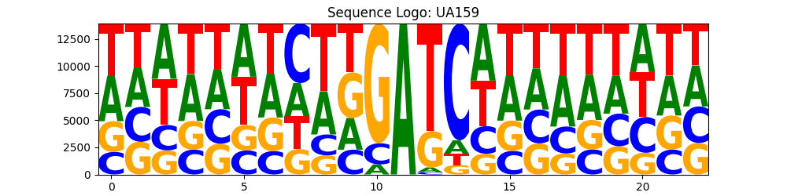

# 07. Constructing a sequence logo
**Placeholder variables are bracketed (`{}`) and must be replaced by an appropriate file path or value.**


A sequence logo visualizes the relative abundance of bases surrounding all of the modification sites of interest. The python script `sequence_logo.py` takes the position of each modification position within a `.tsv` file filtered from the original bedMethyl file (either exported by `filter-pileup.py` or `annotate-tsv.py`).  Using a provided `.fna` file (`.fasta` okay too), the script will pull a modification site position in the genome and extract a window +/- 12 bases upstream and downstream of the modification site. This is iterated for each position present in the `.tsv`, and will generate a sequence logo compiling all sequence windows surrounding the modified bases. Python packages `biopython` and `matplotlib` are required to run the script.

Run the python script:
```sh
python sequence_logo.py {.tsv} {ref.fna} {strain_name}
```

