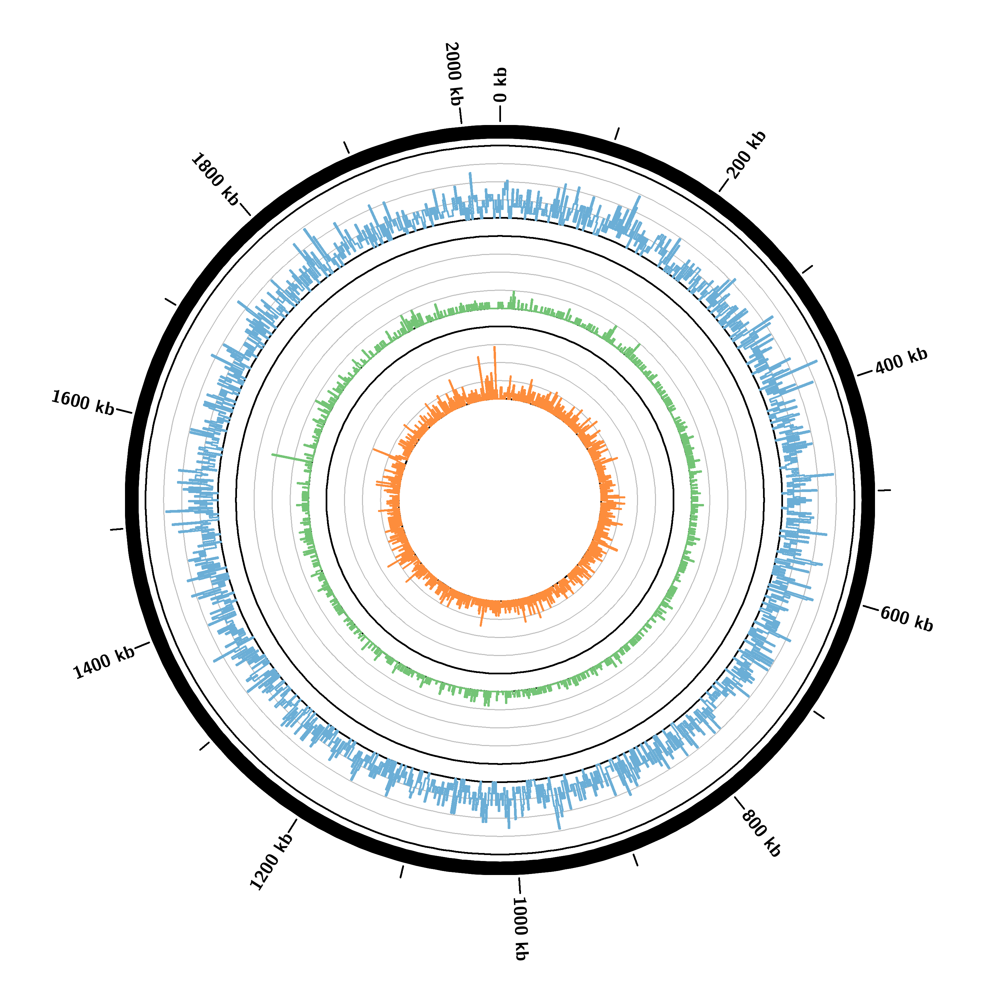

# 09. Generating Circos plots

Circos is a handy program that can be helpful for generating circular density plots of modification sites.This section provides as helpful documentation on how to generate a simple density circos plot.
 


### Installing circos
1. Download Circos on a **local** computer
    * Go to the [Circos Documentation](https://circos.ca/software/download/) to download the most recent version of circos. For example, at the time of writing this document, the most recent version is `circos-0.69-10.tgz`.
    * Once downloaded, run the following line of code to install it, creating a directory `circos-0.69-10/`:
    ```sh
    tar xzf circos-0.69-10.tgz
    ```
    **Note that Circos must be run with `zsh` rather than `bash` due to some dependencies. Therefore, make sure operate circos in a `zsh` terminal window.**
    
2. Test `circos` to make sure everything runs properly:
    ```sh
    circos-0.69-10/bin/circos -module
    ```
    * If this does not work, Pearl dependencies may need to be installed. For macOS this can be installed with `brew`:
        - macOS:
        ```sh
        brew install perl cpanminus gd
        ```
        - Some Pearl dependencies may be missing and can be downloaded with the following command:   
        ```sh
        cpanminus --local-lib=~/perl5 Config::General Font::TTF GD GD::Polyline Clone
        ```
        - Add all the perl dependencies to `~/.zshrc`:
        ```sh
        eval "$(perl -I ~/perl5/lib/perl5 -Mlocal::lib)"
        ```
        - Reload the terminal
        - Test `circos` to make sure everything runs properly:
        ```sh
        circos-0.69-10/bin/circos -module
        ```

### Input files for circos
A few files are needed in order to run a circos plot:
1. `karyotype.txt`
    * This is a `.txt` file that is used as the framework for the plot which contains the chromosome name/number, species, and length of the genome. For example, the text below is what the file would look like for *S. mutans*
        
    `chr - smutans smutans 0 2032925 black`

    **Note that this example is of a bacterial genome, i.e., only one chromosome is present and hence the 'chr' name for the chromosome. For a genome containing more than one chromosome (e.g. eukaryotes), numbering the chromosomes is required for the karyotype file to work.**

2. `density.txt`
    * This is a `.txt` file contains the number of modification sites found within bins of n number of basepairs along the genome. This TXT file is formatted such that it contains a list of `species bin-start bin-end no.-modification-sites`, for example:
    ```
    smutans 0       1000    10
    smutans 1000    2000    9
    smutans 2000    3000    5
    smutans 3000    4000    11
    ...
    ```
    This file can be generated using the python code `bin_modification.py` that takes a modification table `.tsv` as an input file and automatically generate a `density.txt`.

4. `circos.conf`
    * Finally, Circos runs and generates a plot via interpreting a configuration file `.conf`, which in essence is a file with text formatted in its own language to generate highly customizable plots. A file is provided (`circos_example.conf`) to create three concentric density plot of the methylation sites found in *S. mutans*. This file is can be used as a template with comments, denoted by `#`, to help guide users to modulate and change the circos plot as needed.

### Run Circos
```sh
circos-0.69-10/bin/circos -conf {.conf}
```
This will export a `.png` and `.svg` of the generated circos plot.
